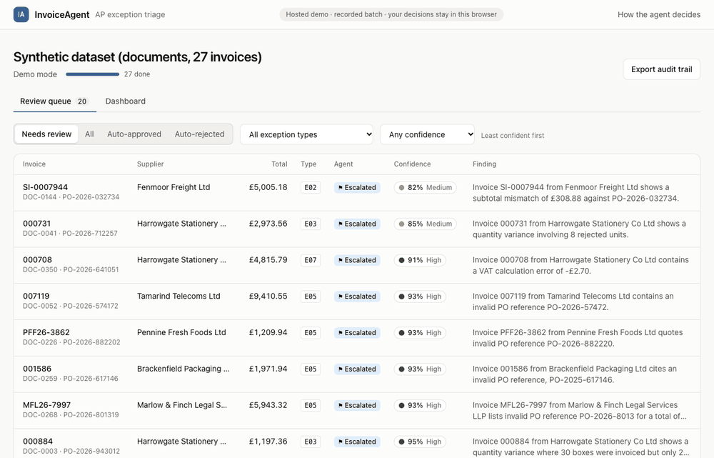
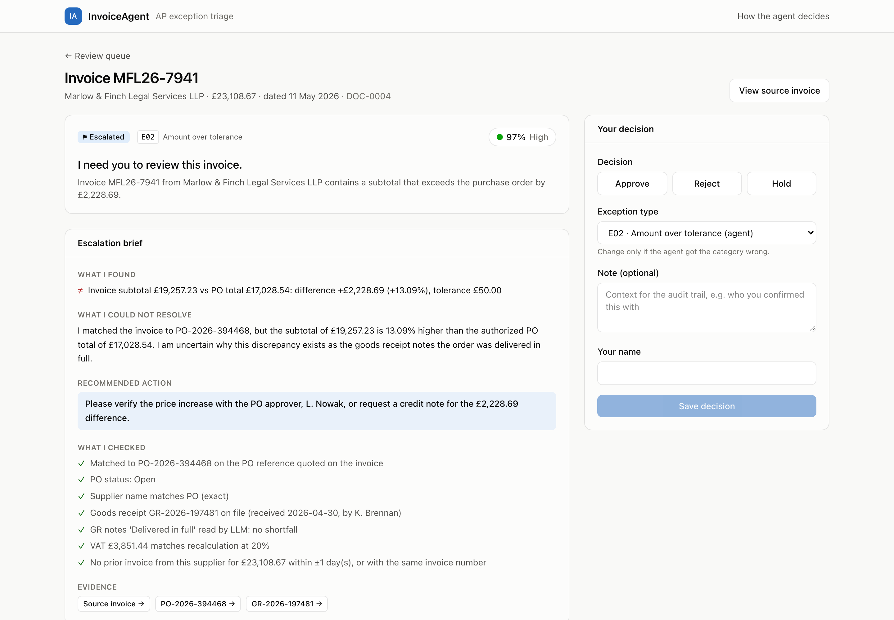
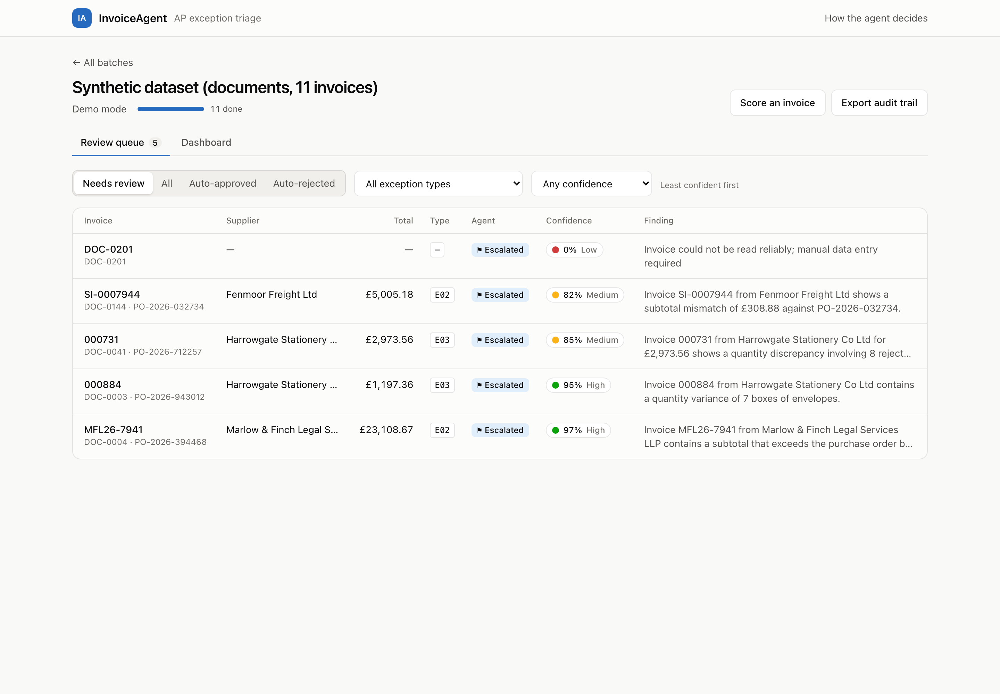
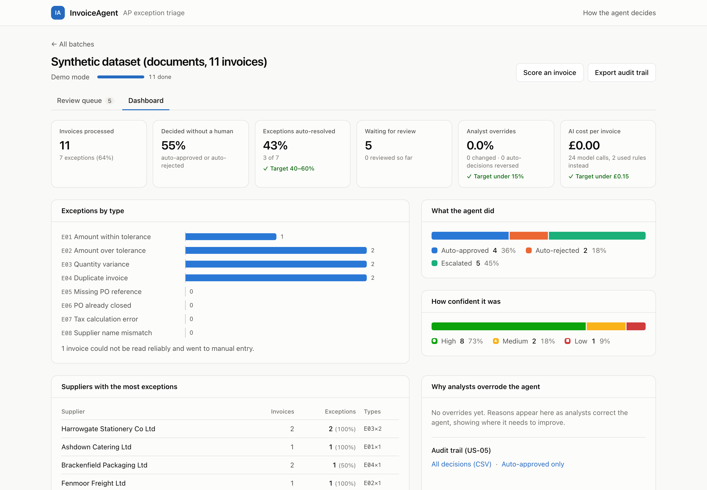
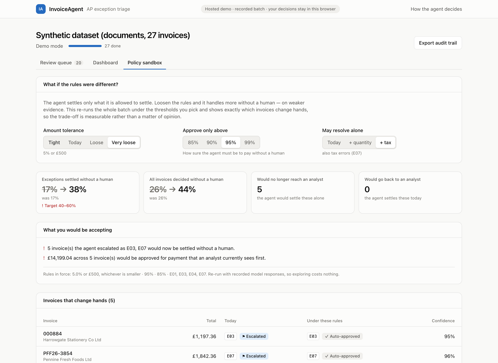
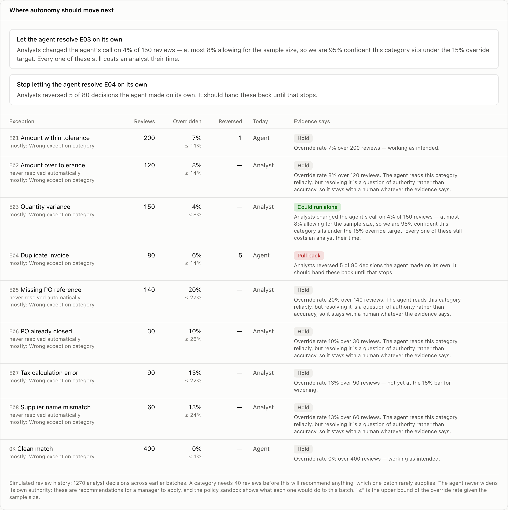

# InvoiceAgent

[](https://github.com/singhaditya261996-boop/invoice-agent/actions/workflows/ci.yml)
[](LICENSE)

An agentic AI system for accounts-payable invoice exception triage.

**[▶ Try the live demo](https://singhaditya261996-boop.github.io/invoice-agent/)** — no install and no
API key: work the review queue on a recorded batch of 27 invoices, read the agent's briefs, and
override its decisions.



## The problem

Large AP teams process thousands of invoices a month against purchase orders, and 20–40% of them
fail automated three-way matching. Those exceptions land on an analyst's desk, where most of the
work is mechanical detective work: finding which PO an invoice belongs to, working out why the
amounts differ, spotting duplicates, and deciding who should resolve it. An analyst handling 80–150
invoices a day spends the bulk of their time on cases whose answer is obvious once the evidence is
assembled.

Existing AP automation handles clean matches well, because they are a rules problem. What it
handles badly is the fuzzy middle: a slightly wrong PO reference, an amount that differs for a
legitimate reason, an invoice for something nobody raised a PO for. That is where analyst time
concentrates, and it is where errors are most expensive. The costs are asymmetric: wrongly
approving a duplicate loses real money, while wrongly escalating a clean invoice costs two minutes.
Any agent working here has to be built around that asymmetry.

## The product

InvoiceAgent reads each invoice, matches it to a purchase order and goods receipt, works out why
they disagree, and then either resolves the case or hands it to an analyst with the evidence already
assembled. It is built for the AP analyst who works the exception queue, with a dashboard for the
manager who owns the SLA and an audit trail for the controller who owns the controls.

**What it may do on its own** — deliberately narrow, and enforced in code rather than by the model:

| Outcome | When | Threshold |
|---|---|---|
| Approve | Clean, or an amount inside tolerance | ≥ 95% confidence |
| Reject | Duplicate invoice | ≥ 85% confidence |
| Escalate | Everything else, and anything it is unsure about | — |

Tolerance is 1% or £50, whichever is smaller, configurable per supplier or cost centre. The
thresholds are asymmetric on purpose: the agent must be very sure to approve, only moderately sure
to reject a duplicate, and escalates whatever it cannot settle.



Everything an analyst needs to act is on one screen: what the agent decided, how sure it is, what it
found, what it checked, what it could not resolve, what it suggests doing, and links to the source
invoice, the PO and the goods receipt. The decision panel is one click, and a reason code is asked
for only when the analyst actually overrides the agent.

The queue opens on what needs review, least confident first, so an analyst starts where the agent is
least sure rather than at the top of an arbitrary list:



The manager's view answers a different question — where exceptions come from, how much the agent
settles on its own, and whether analysts are quietly correcting it:



And because "how much should it do on its own?" is the argument every AP team will actually have,
the policy sandbox re-runs the whole batch under different rules and shows what each setting buys
and costs:



Loosening the rules here lifts auto-resolution from 17% to 38% — and names the five invoices, worth
£14,199, that would be paid without anyone looking at them. It runs on recorded responses, so
exploring costs nothing.

And because the agent should earn autonomy rather than be granted it, override rates per category
drive an explicit recommendation about where the boundary belongs next:



## How it works

Five steps, each feeding the next:

```
Invoice ─▶ 1 Extract ─▶ 2 Match ─▶ 3 Validate ─▶ 4 Classify ─▶ 5 Report ─▶ approve / reject / escalate
             fields       find PO     compare       pick one      write the
             from the     for this    against PO    exception     brief and
             document     invoice     and receipt   and score it  the evidence
```

**The AI model is used in four places only** — reading documents, interpreting free-text receiving
notes, choosing the root cause when several things are wrong at once, and writing the narrative
parts of the brief. Everything else is ordinary code:

| Step | Model? | Why |
|---|---|---|
| Extract fields from a document | **Yes** | Invoice layouts vary too much for templates |
| Match to a PO | No | String and similarity matching is deterministic and auditable |
| Compare amounts, quantities, VAT, duplicates | No | Arithmetic should never be a guess |
| Read "Box 3 damaged, returned 5 units" | **Yes** | Free text needs language understanding |
| Classify one clear discrepancy | No | A direct mapping from finding to category |
| Choose between several discrepancies | **Yes** | Which one is the root cause takes judgement |
| Produce the brief's figures | No | Every number traces to a check |
| Write the brief's explanation | **Yes** | Explaining a finding to a person |

Two rules hold this together. **The model cannot widen its own authority**: the autonomy rules are
applied after it answers, and it may only choose among findings the deterministic checks produced.
**Every model step has a rule-based fallback**, so when the API is unavailable, refuses, or is out
of quota, the agent keeps working and says so in the audit record — which is exactly what happened
during the live pilot below.

An escalation brief, as the agent writes it:

> **Invoice MFL26-7941 from Marlow & Finch Legal Services LLP contains a subtotal that exceeds the
> purchase order by £2,228.69.**
>
> *What I could not resolve:* I matched the invoice to PO-2026-394468, but the subtotal of
> £19,257.23 is 13.09% higher than the authorised PO total of £17,028.54. I am uncertain why this
> discrepancy exists as the goods receipt notes the order was delivered in full.
>
> *Recommended action:* Please verify the price increase with the PO approver, L. Nowak, or request
> a credit note for the £2,228.69 difference.

## Key product decisions

- **The autonomy boundary is narrower than the target it has to hit.** Only two exception types may
  be resolved without a human, which caps auto-resolution at 32.5% against a 40–60% goal. Widening
  it is a decision for after the agent has earned trust on measured override rates, not before — and
  the policy sandbox above quantifies each option rather than leaving it to opinion.
  ([D-01](docs/decision-log.md#d-01-autonomy-boundary-set-at-a-conservative-threshold))
- **The model is used where language is, and nowhere else.** It costs less, it is easier to debug,
  and the steps a controller will ask about stay deterministic.
  ([D-03](docs/decision-log.md#d-03-llm-used-selectively-not-end-to-end))
- **Confirming the agent is not the same as overriding it.** A reason code is required only for a
  real correction, so the override rate stays a measure of agent accuracy rather than of clicks.
  ([D-12](docs/decision-log.md#d-12-confirming-an-escalation-is-a-review-not-an-override))
- **Autonomy is earned, not granted.** Override rates per category drive recommendations to widen or
  narrow the boundary — behind a minimum sample and a confidence bound — but the agent never applies
  them to itself, and some categories are never eligible however good the evidence.
  ([D-16](docs/decision-log.md#d-16-autonomy-is-recommended-by-evidence-never-widened-by-the-agent-itself))
- **Two duplicate-payment routes were closed after the evaluation found them**, not after a user
  did. An invoice waiting for manual entry still counts for duplicate checks, and the same PO billed
  twice for the same amount is suspicious on any date.
  ([D-09](docs/decision-log.md#d-09-invoices-awaiting-manual-entry-stay-in-the-duplicate-check-history),
  [D-10](docs/decision-log.md#d-10-the-same-po-billed-twice-for-the-same-amount-is-a-duplicate-signal-on-any-date))

Full log, including the ones still open: [docs/decision-log.md](docs/decision-log.md). To see the
mechanism rather than read about it: [one invoice, end to end](docs/walkthrough.md).

## Evaluation results

Two kinds of run. The first covers all 500 synthetic invoices with the rules only. The second is a
small live pilot that actually reads invoice documents with a model.

| | Rules only, 500 invoices | Live pilot, 27 invoices |
|---|---|---|
| Extraction accuracy | not exercised | **100% of fields, all 27 invoices** |
| Match accuracy | 100% | 100% |
| Classification accuracy | 100% | 100% |
| Action accuracy | 100% | 100% |
| Auto-approval precision | 100% | 100% |
| Escalation recall | 100% | 100% |
| False approvals | **0** | **0** |
| Median latency | — | 23.8 s (target < 30 s) |
| Cost per invoice | — | £0 (free tier) |

**Robustness.** With deliberate misreads injected into up to 100% of invoices, at the high
confidence an overconfident model would report, **369 of 369 misreads that could change a payment
were caught** by the arithmetic checks or the three-way match. None was auto-approved.

**How to read these numbers.** The synthetic data was generated from the same rules the agent
applies, so rule-based steps score near 100% by construction — it is a regression baseline and a
safety test, not a production accuracy estimate. The live pilot ran on **Gemini 3 Flash**, not on
the model this product would ship with, because it was free.

A perfect score on 27 invoices is a small sample, not a claim about production accuracy — and the
sittings that got there are more informative than the final number. The free tier allows 20 requests
per model per day, so the pilot was built over four sittings, each replaying the last one's recorded
responses. Along the way the quota cut off invoices mid-run and an overloaded model returned 503s.
Every time, the agent escalated the affected invoice for manual entry instead of guessing at it —
which is the behaviour that matters, and it was observed against a real API rather than a stub.

Latency comes from the one sitting whose calls ran without throttling (five invoices), and
auto-resolution rate at this sample size is too noisy to report against the 40–60% target.

Full results, including what each run does not show:
[eval/results/SUMMARY.md](eval/results/SUMMARY.md).

## Limitations and risks

- **No real invoice has been through this system.** Every number above comes from synthetic data.
- **Extraction is the weakest link** and the least tested: 27 invoices on one model.
- **Confidence scores are not yet calibrated.** The mechanism is built and measured (14.5% error
  as-is, 0.4% when fitted), but fitting it needs a live run over the full set, so the green/amber
  bands currently understate certainty.
  ([D-04](docs/decision-log.md#d-04-confidence-scores-are-calibrated-not-raw-model-probabilities))
- **Auto-resolution cannot reach its target** under the current autonomy boundary. That is a product
  decision to revisit, not a bug.
- **The feedback loop advises rather than adapts**: override rates drive recommendations about where
  autonomy belongs, but a person applies them and nothing is learned automatically.
- **Adversarial invoices are out of scope**, as are multi-currency and non-standard VAT.
- Batches live in memory; there is no authentication or access control.

Honest summary: [docs/model-card.md](docs/model-card.md) · how it fails:
[docs/failure-taxonomy.md](docs/failure-taxonomy.md).

## What I would do next

1. **Run the full live evaluation** on the shipping model, fit the calibration table on its errors,
   and re-check the confidence bands. Everything marked "not measured" above depends on this.
2. **Settle the two open decisions:** the auto-resolution ceiling, and whether extraction confidence
   should keep suppressing auto-approvals when the arithmetic checks already catch misreads.
3. **Let the loop adapt, not just advise.** Per-category autonomy recommendations are built; what is
   missing is anything learned automatically, such as per-supplier tolerances inferred from
   "contractual adjustment" overrides.
4. **Shadow-mode pilot on real invoices.** The agent proposes, humans decide, and the two are
   compared for a period before any autonomy is switched on.
5. **ERP integration** to replace batch upload, then supplier self-service for the exceptions that
   are really the supplier's to fix.

## Try it

The [hosted demo](https://singhaditya261996-boop.github.io/invoice-agent/) runs in the browser with
no backend. To run the whole system locally, demo mode replays recorded model responses, so it needs
no API key and costs nothing:

```bash
make setup    # Python venv + frontend dependencies
make demo     # API on :8000, UI on :5173
```

In the UI choose **Demo** and **Documents** with 16 invoices to replay the recorded pilot, or
**Rules only** with **Structured** input to run all 500 with no model at all.

`make test` runs the suite, `make eval` scores all 500 invoices with the rules only, and `make data`
regenerates the dataset.

Evaluation runs:

```bash
python -m eval.run_eval --mode offline                       # all 500, rules only, free
python -m eval.run_eval --simulate-extraction-errors 0.3     # robustness, free
python -m eval.run_eval --estimate --input documents         # projected live cost, free
```

For a live run, put `ANTHROPIC_API_KEY` in `.env` and add
`--mode live --input documents --limit 40 --max-cost-usd 5`. Live runs stop at the spending cap.
To use Gemini instead, install the extra (`pip install -e ".[dev,google]"`), set `GOOGLE_API_KEY`,
and pass `--provider google`.

## Repo tour

```
docs/              product thinking: PRD, decision log, evaluation framework, failure taxonomy,
                   trust design, model card
app/agent/         the five-step pipeline, the tools it calls, and the model clients
app/api/           FastAPI endpoints
app/frontend/      React + Tailwind UI
data/generator/    synthetic data generator and its design notes
eval/              evaluation runner, scoring, extraction-error simulation, results
tests/             67 tests: pipeline, API, generator invariants, evaluation harness
```

## Tech stack

Python, FastAPI, Pydantic, RapidFuzz. Claude (Anthropic SDK) as the default model, with Gemini as an
alternative provider behind the same interface. React, TypeScript and Tailwind for the UI. pytest.
